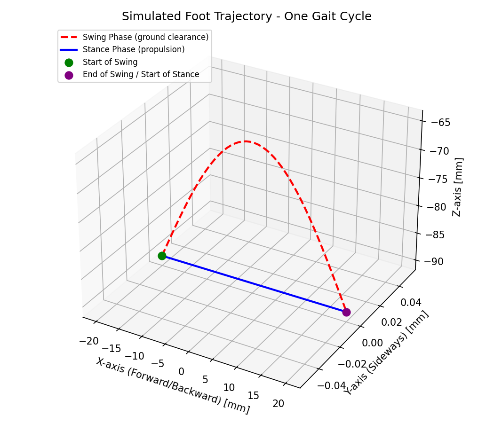
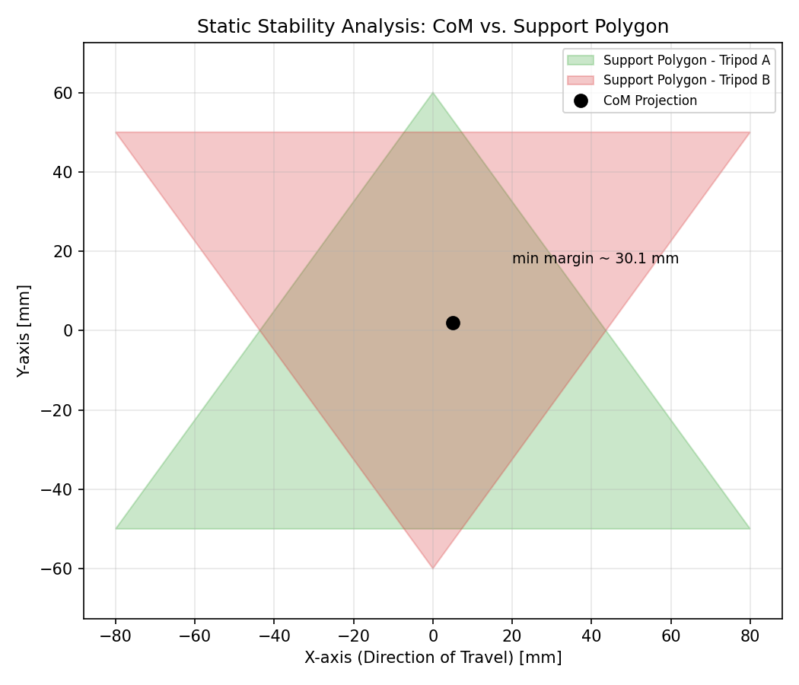
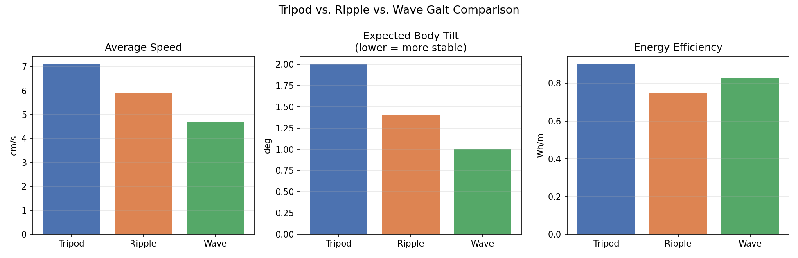
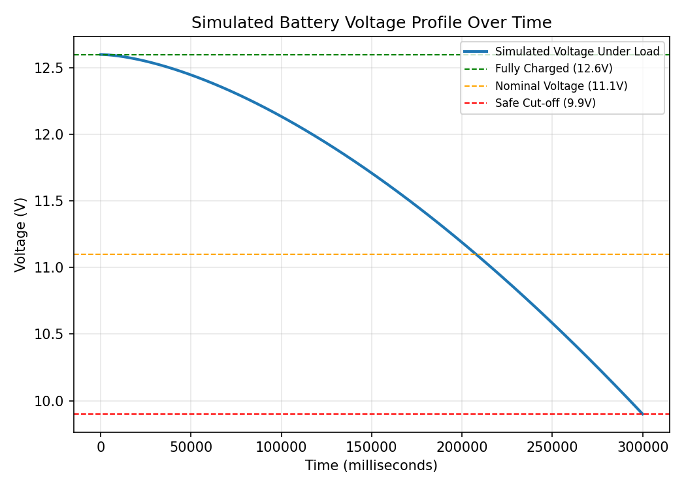
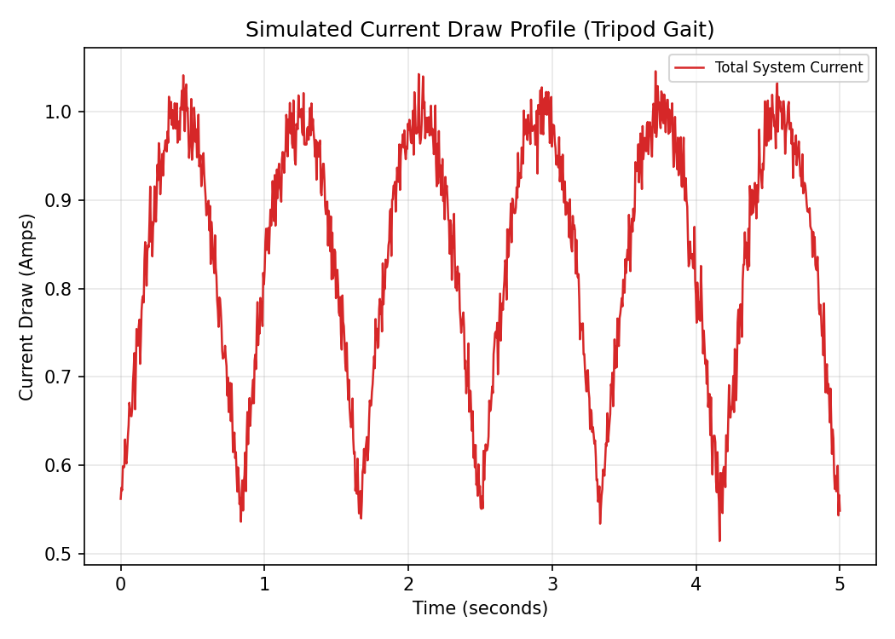

# AntBot — An Accessible Hexapod Platform for Surveillance

Simulation & documentation package for the published paper:

> **Design and Experimental Validation of AntBot: An Accessible Hexapod
> Platform for Surveillance** — 2026 Sixth International Conference on
> Advances in Electrical, Computing, Communications and Sustainable
> Technologies (ICAECT), IEEE.
> DOI: 10.1109/ICAECT68478.2026.11426098

Authors: Rishitha C, Divya Rithanya, Karthikeya Y, Kaushal S, Akhil V. M
Amrita School of Artificial Intelligence, Amrita Vishwa Vidyapeetham, India

---

## Folder Structure

```
AntBot-Project/
├── README.md
├── scripts/
│   ├── leg_inverse_kinematics.py     -> Fig. (IK sample outputs)
│   ├── tripod_gait_trajectory.py     -> images/foot_trajectory.png
│   ├── static_stability_margin.py    -> images/stability_analysis.png
│   ├── gait_comparison.py            -> images/gait_comparison.png
│   └── power_analysis.py             -> images/battery_voltage.png, images/current_draw.png
├── images/
│   ├── foot_trajectory.png
│   ├── stability_analysis.png
│   ├── gait_comparison.png
│   ├── battery_voltage.png
│   └── current_draw.png
└── outputs/
    └── ik_sample_output.txt
```

Each script below is documented with its **function signature, inputs,
outputs**, and the **image it produces**, so you can see exactly what
goes in and what comes out.

---

## 1. Leg Inverse Kinematics

**Script:** `scripts/leg_inverse_kinematics.py`

**Function:**
```python
leg_inverse_kinematics(target, L1, L2, L3)
```

| | |
|---|---|
| **Input** | `target = (x, y, z)` desired foot position (mm); `L1, L2, L3` = coxa/femur/tibia link lengths (mm) |
| **Output** | `(theta1, theta2, theta3)` — coxa, femur, tibia joint angles in degrees |
| **Method** | Geometric IK — Eqs. 1–8 of the paper (atan2 for coxa, law of cosines for femur/tibia) |

**Sample run** (`L1=30, L2=60, L3=90` mm):

```
target(x,y,z)=(120, 20, -90) mm  ->  coxa=9.46 deg,  femur=-5.60 deg,  tibia=26.39 deg
target(x,y,z)=(140, 0, -95)  mm  ->  coxa=0.00 deg,  femur=-23.22 deg, tibia=60.77 deg
target(x,y,z)=(100, -15, -80) mm ->  coxa=-8.53 deg, femur=8.84 deg,  tibia=-1.28 deg
```
(Full output saved in `outputs/ik_sample_output.txt`)

---

## 2. Tripod Gait — Foot Trajectory

**Script:** `scripts/tripod_gait_trajectory.py`

**Function:**
```python
tripod_gait_trajectory(step_length, step_height, ground_z, num_points=50)
```

| | |
|---|---|
| **Input** | `step_length` (mm, forward step), `step_height` (mm, max lift), `ground_z` (mm, stance height), `num_points` (samples per phase) |
| **Output** | `x, y, z` arrays — the foot position across one full gait cycle (swing then stance) |
| **Used values** | `step_length=40mm, step_height=25mm, ground_z=-90mm` |

**Output image:** `images/foot_trajectory.png`



The dashed red arc is the **swing phase** (semi-elliptical, for ground
clearance); the solid blue line is the **stance phase** (straight line
at ground level, for propulsion) — matching Fig. 3 of the paper.

---

## 3. Static Stability Margin

**Script:** `scripts/static_stability_margin.py`

**Function:**
```python
static_stability_margin(com_xy, support_polygon)
```

| | |
|---|---|
| **Input** | `com_xy = (x, y)` ground-projected center of mass (mm); `support_polygon` = list of 3 vertices (mm) of the stance-leg triangle |
| **Output** | `margin` (mm) — distance from CoM to nearest polygon edge. Positive = stable (inside), negative = unstable (outside) |

**Sample run:**
```
Stability margin vs Tripod A: 30.07 mm
Stability margin vs Tripod B: 32.42 mm
Minimum stability margin: 30.07 mm
```

**Output image:** `images/stability_analysis.png`



Matches the ~30 mm minimum stability margin reported in the paper
(Fig. 4) — the CoM projection stays inside both alternating tripod
support triangles throughout the gait cycle.

---

## 4. Gait Comparison (Tripod vs. Ripple vs. Wave)

**Script:** `scripts/gait_comparison.py`

**Input data** (from the paper's Table II & III):

| Gait | Avg. Speed (cm/s) | Body Tilt (deg) | Avg. Power (W) | Energy/m (Wh/m) |
|---|---|---|---|---|
| Tripod | 7.1 | 2.0 | 6.5 | 0.90 |
| Ripple | 5.9 | 1.4 | 5.4 | 0.75 |
| Wave | 4.7 | 1.0 | 5.0 | 0.83 |

**Output:** bar charts comparing speed, body tilt, and energy efficiency.

**Output image:** `images/gait_comparison.png`



Tripod gait wins on speed but has the highest body tilt; wave gait is
the most stable but slowest; ripple is the middle-ground compromise.

---

## 5. Power Analysis — Battery Voltage & Current Draw

**Script:** `scripts/power_analysis.py`

### 5a. Battery voltage profile
```python
battery_voltage_profile(capacity_mah, nominal_v, full_v, cutoff_v, avg_power_w, duration_ms)
```
| | |
|---|---|
| **Input** | Battery capacity (1800 mAh), nominal (11.1V) / full (12.6V) / cutoff (9.9V) voltages, avg power draw (6.5W), duration (300,000 ms) |
| **Output** | `t_ms, voltage` — simulated discharge curve over time |

**Output image:** `images/battery_voltage.png`



### 5b. Current draw profile
```python
current_draw_profile(avg_current_a, gait_freq_hz, duration_s, peak_factor)
```
| | |
|---|---|
| **Input** | Baseline current (0.55A), gait step frequency (1.2Hz), duration (5s), peak amplitude factor |
| **Output** | `t_s, current` — cyclical current draw over time |

**Output image:** `images/current_draw.png`



The cyclical peaks correspond to the **tripod gait's power stroke** —
three legs actuating simultaneously during each stance phase, matching
Fig. 6 of the paper.

---

## How to Run

Requires Python 3 with `numpy` and `matplotlib`:

```bash
pip install numpy matplotlib
cd scripts
python3 leg_inverse_kinematics.py
python3 tripod_gait_trajectory.py
python3 static_stability_margin.py
python3 gait_comparison.py
python3 power_analysis.py
```

Each script prints its results to the console and (re)generates its
corresponding image in `../images/`.

---

## Note on Hardware

The mechanical fabrication and electronic assembly of the physical
AntBot prototype were carried out by an external fabrication partner
based on the team's design specification. This package documents the
**design, kinematics, and simulation results** reported in the
published paper — it is not a hardware build guide.

---

## Citation

```bibtex
@inproceedings{antbot2026,
  author    = {Rishitha C and Divya Rithanya and Karthikeya Y and Kaushal S and Akhil V. M},
  title     = {Design and Experimental Validation of AntBot: An Accessible Hexapod Platform for Surveillance},
  booktitle = {2026 Sixth International Conference on Advances in Electrical, Computing, Communications and Sustainable Technologies (ICAECT)},
  year      = {2026},
  publisher = {IEEE},
  doi       = {10.1109/ICAECT68478.2026.11426098}
}
```
